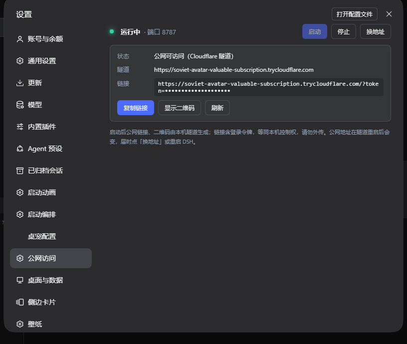

# dsh-public-edge · Public access for DSH

A standard DeepSeek Harness (DSH) plugin that adds a **Public access** panel to Settings: start/stop a Cloudflare quick tunnel with one click, copy the tokenized public URL and QR code, and use the built-in LAN bridge (Host rewrite / Origin stripping / WebSocket passthrough). `cloudflared` is downloaded automatically when missing. Works on Windows, macOS and Linux.



## Install

> Not published to npm (the in-app market will not find it). Install straight from the GitHub repository URL:

```
https://github.com/ArtificialAngels/dsh-public-edge
```

**Option A — paste the repo URL into DSH (no command line):** left sidebar **Plugins** → **Add plugin** → paste the URL → **Install** → fully restart DSH.

**Option B — CLI:**

```powershell
# DSH-Portable on Windows
E:\DSH-Portable\dsh.exe plugin --profile web add https://github.com/ArtificialAngels/dsh-public-edge

# pinned
E:\DSH-Portable\dsh.exe plugin --profile web add github:ArtificialAngels/dsh-public-edge#v0.2.1
```

**Option C — local tarball / directory** (when GitHub is unreachable): download the release asset `dsh-public-edge-0.2.1.tgz`, then paste the local file/directory path into Add plugin, or:

```powershell
E:\DSH-Portable\dsh.exe plugin --profile web add file:E:/path/to/dsh-public-edge-0.2.1.tgz
```

**Restart DSH completely** afterwards. Then open **avatar menu (bottom-left) → Settings → Public access** and press Start. The first start downloads `cloudflared` (~55 MB); mainland-China users can fall back to mirrors via the `downloadMirrors` config.

## Usage

1. In DSH open **avatar menu (bottom-left) → Settings → Public access → Start**.
2. **Copy link** and open it in a phone browser (first visit sets a 30-day cookie), or open `http://127.0.0.1:8788/pair` on the PC for a QR code.
3. Press **Stop** when done; press **New address** to refresh the tunnel domain.

## Config (optional)

```yaml
- id: public-edge
  config:
    port: 8787
    autoStart: true
    cloudflaredPath: ""
    downloadMirrors: ["", "https://gh-proxy.com/", "https://ghfast.top/"]
```

## Security

- The URL token is the DSH process token: full control of this machine. Treat the link as a password.
- Cloudflare terminates TLS and can see plaintext; quick tunnels have no SLA and random hostnames.
- Public access is protected by the token only (no password / 2FA). Stop the tunnel when not in use; rebooting DSH rotates the token and refresh the address if the link leaked.
- `/pair` is served on loopback only; tunneled responses get `Secure` cookies and HSTS.

## License

MIT © ArtificialAngels
