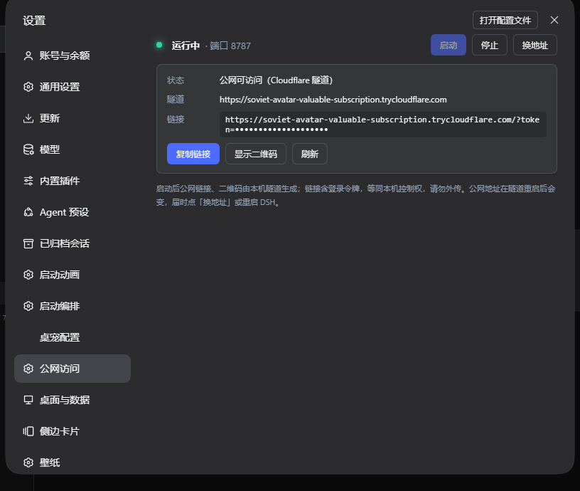

# dsh-public-edge · 公网访问

给 **DeepSeek Harness（DSH）** 的「公网访问」标准插件：在设置里一键启停 Cloudflare 隧道，拿到带 token 的公网链接和二维码；内置局域网桥，手机/别的电脑也能连。支持 Windows / macOS / Linux，`cloudflared` 缺失时自动下载。



## 功能

- **一键启停**：设置 → 公网访问 → 启动/停止 Cloudflare quick tunnel（免账号、免域名、真 HTTPS）。
- **复制链接**：面板显示 `https://<随机>.trycloudflare.com/?token=…`，一键复制；手机浏览器打开即可（首次后 cookie 有效 30 天）。
- **二维码**：面板内展示，或本机打开 `http://127.0.0.1:8788/pair`（只允许本机）。
- **换地址**：隧道重连拿到新域名，点一下即可刷新。
- **局域网桥**：监听 `0.0.0.0:8787`（可配置）→ DSH 本机 Web 端口，自动改写 `Host`、剥掉 `Origin` / `Sec-Fetch-*`、透传 WebSocket，所以手机连的是同一个地址，局域网/公网都走它。
- **零依赖工具链**：`cloudflared` 不在时自动下载到 `~/.dsh/dsh-public-edge/`，GitHub 直连不通会自动走镜像。
- **安全加固**：桥上的 `/pair` 一律 404（token 页只在本机回环端口）；经隧道的响应自动补 `Secure` cookie 和 HSTS；控制接口走 DSH 已鉴权的 `/api` 通道，只有本机 owner 能调。

## 安装（标准 DSH 插件方法）

`dsh plugin` 会把参数原样转发给 profile 目录里的 pnpm，因此支持 pnpm 的全部安装语法。**装完完全退出 DSH 再打开**（host 插件在启动时加载）。

### 方式 A：从 GitHub 安装（推荐）

```powershell
# Windows / DSH-Portable
E:\DSH-Portable\dsh.exe plugin --profile web add github:ArtificialAngels/dsh-public-edge

# 固定版本
E:\DSH-Portable\dsh.exe plugin --profile web add github:ArtificialAngels/dsh-public-edge#v0.2.0
```

*非 Portable 安装：把可执行文件换成你的 `dsh`，profile 名按实际使用（默认 `web`）。*

### 方式 B：从 Release 的 tgz 安装

```powershell
E:\DSH-Portable\dsh.exe plugin --profile web add https://github.com/ArtificialAngels/dsh-public-edge/releases/download/v0.2.0/dsh-public-edge-0.2.0.tgz
```

### 方式 C：本地 tgz

```powershell
E:\DSH-Portable\dsh.exe plugin --profile web add file:E:/path/to/dsh-public-edge-0.2.0.tgz
```

### 方式 D：手动（等价于 A，用于 `dsh plugin` 不可用的时候）

```powershell
cd <DSH_HOME>\profiles\web          # 例如 E:\DSH-Portable\data\dsh-home\profiles\web
pnpm add github:ArtificialAngels/dsh-public-edge
```

然后把 `"dsh-public-edge"` 加进同目录 `package.json` 的 `dsh.profile.bundles` 数组，重启 DSH。

> 装完重启 DSH，在 **头像菜单 → 设置 → 公网访问** 里点「启动」。第一次启动会下载 `cloudflared`（约 55 MB，视网络 1–5 分钟），面板会显示进度/错误。

### 验证

```powershell
# 已安装版本
Get-Content E:\DSH-Portable\data\dsh-home\profiles\web\node_modules\dsh-public-edge\package.json

# 启动日志里应有
# [public-edge] tunnel url: https://xxxx.trycloudflare.com
Get-Content E:\DSH-Portable\data\logs\dsh.stdout.log | Select-String "public-edge"
```

## 使用

1. 打开 DSH，点**左下角头像（账号菜单）→ 设置 → 公网访问 → 启动**：状态变成「运行中」，出现隧道地址和带 token 的链接。
2. 点 **复制链接**，手机浏览器打开；或本机开 `http://127.0.0.1:8788/pair` 扫码。
3. 首次带 token 打开后，浏览器会拿到 cookie（30 天），之后直接开裸地址也能进。
4. 不用时点 **停止**；域名变了点 **换地址**。

> 手机端「Helm·DSH」一类 App 目前只认 `主机:端口` 的局域网地址，公网请用浏览器。

## 配置

默认配置一般不用改。要改端口/关闭自动启动等，在 profile 的 `cordis.patch.yml` 里按 id 覆盖：

```yaml
- id: public-edge
  config:
    port: 8787                # 桥端口（局域网访问端口 = 它）
    autoStart: true           # DSH 启动时自动开隧道
    cloudflaredPath: ""       # 留空 = 自动；也可指定已有的 cloudflared 可执行文件
    downloadMirrors:          # cloudflared 下载镜像前缀，按顺序尝试（"" = GitHub 直连）
      - ""
      - "https://gh-proxy.com/"
      - "https://ghfast.top/"
```

| 字段 | 默认 | 说明 |
| --- | --- | --- |
| `port` | `8787` | 局域网桥端口；被占用会启动失败（面板显示错误），改一个空闲端口即可 |
| `autoStart` | `true` | DSH 启动后自动拉起隧道 |
| `cloudflaredPath` | `""` | 留空自动下载到 `~/.dsh/dsh-public-edge/cloudflared[.exe]` |
| `downloadMirrors` | 见上 | 国内网络 GitHub 直连失败时用的镜像，可自行增删 |

## 安全须知

- 链接里的 `token` 是 DSH 进程令牌，**等同这台电脑的控制权**（终端/文件/插件都在里面），别外传。
- Cloudflare 是 TLS 终点：手机↔Cloudflare 是 HTTPS，但 **Cloudflare 能看到明文**；quick tunnel 没有 SLA、地址随机。
- 公网入口的认证**完全依赖 token**（没有密码/二次验证）。建议：不用时点「停止」；泄露后重启 DSH（token 换新）+ 点「换地址」。
- 需要固定域名/额外登录层：用 Cloudflare 账号做 named tunnel + Access，本插件不含这部分。
- 局域网桥监听 `0.0.0.0`，Windows 首次可能弹防火墙提示，只放行「专用网络」即可；也可只在需要时启动。

## 卸载

```powershell
E:\DSH-Portable\dsh.exe plugin --profile web remove dsh-public-edge
```

重启 DSH。可选：删除 `~/.dsh/dsh-public-edge/`（下载的 cloudflared）。

## 开发

```text
lib/index.js          host 插件：桥 + 隧道 + 控制接口（/api/dsh-public-edge/state|control）
lib/client.js         设置页「公网访问」面板（slots: settings.section）
cordis.patch.yml      bundle 插入片段
test/smoke.mjs        mock ctx 冒烟测试（桥、/pair、state/control、cookie 加固、启停）
```

```powershell
node test/smoke.mjs   # 需要本机 DSH Web 在 127.0.0.1:3080 提供登录 401；测试会占用 8877/8878 端口
```

## License

MIT © ArtificialAngels
